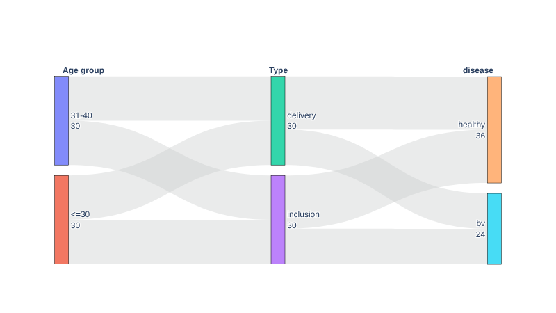
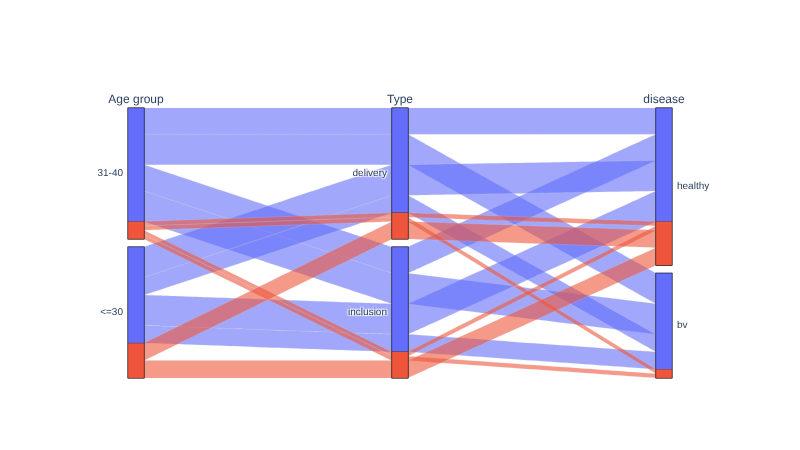
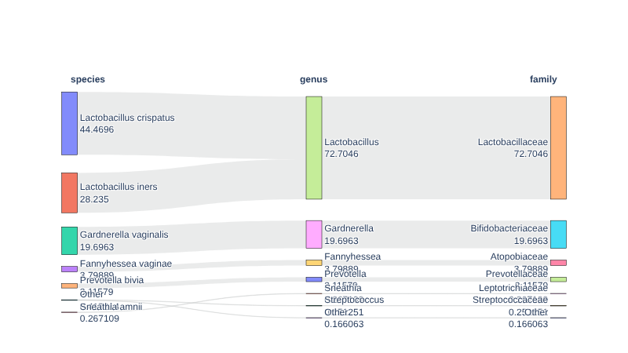

.. _category_flows:

*****************************************
Category flows: Sankey and parallel plots
*****************************************

These plots show how samples are distributed across several categorical variables at once, for example age group,
sample type and disease status, or how species collapse into genera and families. The two kinds answer different
questions:

``kind="sankey"`` (default): boxes with counts, ribbons between neighbouring columns
    Best for two or three columns and for taxonomy, where every species belongs to exactly one genus. Ribbons only
    join *neighbouring* columns, so a sample cannot be followed across three columns or more.

``kind="parcats"``: parallel categories
    One ribbon per combination of categories, followed through every column, and coloured by a variable of your
    choice (``color_by``). Best for following samples across many columns.

Both are interactive Plotly figures. Input is the same as everywhere in Moonstone: the metadata file with one row
per sample, and the count table (see :ref:`correlation` for example files, ``metadata.csv`` and
``species_counts.tsv``).

Metadata columns
================

.. code-block:: python

    import pandas as pd
    from moonstone.plot import plot_category_flows

    metadata = pd.read_csv("metadata.csv", index_col=0)
    metadata["age_group"] = pd.cut(metadata["age"], [0, 30, 40, 100], labels=["<=30", "31-40", ">40"]).astype(object)

    plot_category_flows(
        metadata, columns=["age_group", "Type", "disease"],
        column_titles={"age_group": "Age group"},
        output_file="flows.html",
    )

Same columns with ``kind="parcats"`` and ``color_by="antibiotics"`` (a column that does not need to be plotted):

Options
-------

- ``columns``: the columns to plot, from left to right.
- ``order={"Type": ["inclusion", "delivery"]}``: order of the categories of a column, from top to bottom. By
  default from the largest to the smallest; categories you leave out follow.
- ``column_titles``: titles shown above the columns.
- ``weights``: a series (same index as the data) to make the ribbon widths something other than a number of samples.
- ``plotting_options``, ``show`` and ``output_file``: as for the other Moonstone plots.

**Missing values** are neither filled in nor dropped: they are shown as their own category, ``(missing)``, and a
warning gives how many there are per column. Numbers are treated as categories, so bin a continuous variable first
(as ``age_group`` above).

Taxonomic levels of a count table
=================================

.. code-block:: python

    from moonstone.plot import plot_taxonomy_flows

    # counts: one row per taxon, index with one level per rank (kingdom ... species), one column per sample
    plot_taxonomy_flows(counts, levels=["species", "genus", "family"], top_n=6)

- ``levels``: the ranks to show, from left to right. Any order works (species to family, or family to species).
- ``weight``: the width of a ribbon is, by default, the relative abundance (%) of the taxon averaged across samples
  (``"mean_relative_abundance"``). ``"total_reads"`` sums the reads instead.
- ``top_n``: number of taxa kept per level, the others being lumped into ``Other``. The widths are computed from
  all the taxa first, so nothing is lost; only the drawing is simplified. ``top_n=None`` keeps every taxon.
- A taxon not classified down to one of the levels is shown as ``(missing)`` in that level.

Many tiny boxes overlap their labels; lower ``top_n`` if the plot gets crowded.

Existing ``MetadataParser.visualize_categories`` still works; the functions above replace it and are not tied to
the metadata parser.
